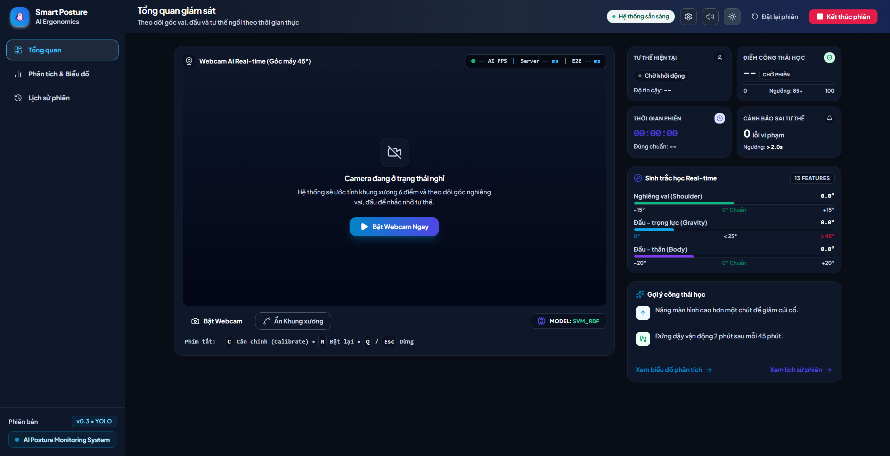
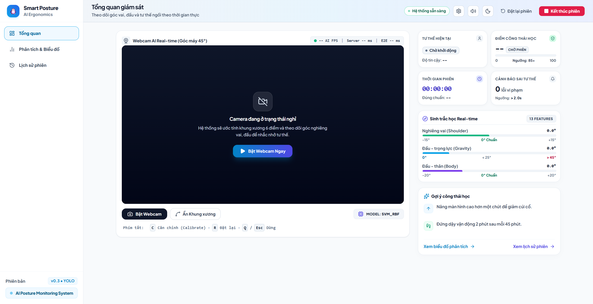
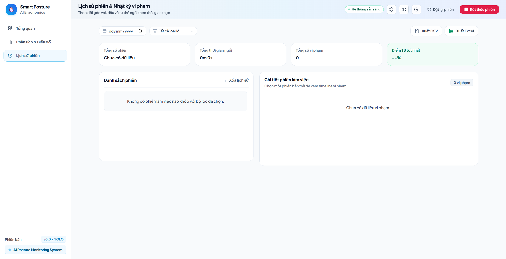
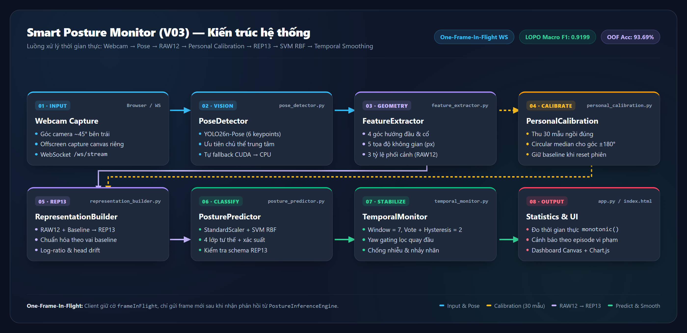

<div align="center">

# 🪑 Smart Posture Monitor

### Hệ thống giám sát tư thế ngồi theo thời gian thực qua Webcam với Personal Calibration & REP13

<p>
  
  
  
  
  
  
</p>

**Phát hiện tư thế ngồi sai theo thời gian thực • Cá nhân hóa theo từng người dùng • Chạy hoàn toàn Offline trên Localhost**

[Tổng quan](#-1-tổng-quan-overview) • [Demo](#-2-demo) • [Tính năng](#-3-tính-năng-chính-features) • [Kiến trúc](#-4-kiến-trúc-hệ-thống-architecture) • [Cài đặt](#-6-cài-đặt-installation) • [Sử dụng](#-7-hướng-dẫn-sử-dụng-usage) • [Kết quả](#-8-thực-nghiệm--kết-quả-experiments--results) • [Đóng góp](#-11-ghi-nhận-đóng-góp-contributors)

</div>

---

## 📌 1. Tổng quan (Overview)

**Smart Posture Monitor** là hệ thống giám sát tư thế ngồi làm việc theo thời gian thực qua webcam thông thường, tập trung giải quyết bài toán sai lệch tỷ lệ cơ thể giữa các cá nhân và hiện tượng nhảy nhãn (*flickering*) khi suy luận liên tục.

Hệ thống sử dụng **YOLO26n-Pose** để trích xuất 6 keypoints vùng thân trên (tối ưu cho góc camera lệch ~45° bên trái), kết hợp **Personal Calibration** (30 mẫu tư thế chuẩn bằng *circular median*) để tạo biểu diễn đặc trưng bất biến tỷ lệ **REP13**, phân loại 4 tư thế (`correct`, `forward_slouch`, `lean_left`, `lean_right`) bằng **SVM (RBF Kernel)** và hậu xử lý qua **Temporal Smoothing + Yaw Gating**.

---

## 🎬 2. Demo

Giao diện **Realtime Dashboard** chạy tại `http://127.0.0.1:8000` (hỗ trợ cả **Dark Mode** và **Light Mode**):

<p align="center">
  
</p>

*Hình 1. Giao diện giám sát tư thế thời gian thực (Dark Mode) với khung webcam 6 keypoints, chỉ số sinh trắc học và điểm công thái học.*

<details>
<summary>📸 Xem thêm ảnh giao diện Light Mode & Lịch sử phiên</summary>

<p align="center">
  
  
</p>

</details>

- **Tổng quan (Live Monitor):** Hiển thị webcam trực tiếp với skeleton 6 keypoints, nhãn tư thế ổn định, độ tin cậy, FPS/độ trễ thực tế, điểm công thái học và 3 góc sinh trắc học (*Vai*, *Đầu–Trọng lực*, *Đầu–Thân*).
- **Phân tích (Analytics):** Biểu đồ xu hướng tư thế theo thời gian thực (`Chart.js`) và tỷ lệ ngồi đúng/sai trong phiên.
- **Lịch sử phiên (Session History):** Lưu nhật ký phiên làm việc trên trình duyệt, timeline vi phạm và hỗ trợ xuất CSV / Excel.

---

## ✨ 3. Tính năng chính (Features)

- **👤 Personal Calibration (30 mẫu):** Thu thập nhanh 30 frame ngồi thẳng (`correct`) để dựng baseline cá nhân với *circular median*, xử lý chuẩn xác tại biên góc $\pm 180^\circ$.
- **📐 Biểu diễn đặc trưng REP13:** Chuẩn hóa độ dịch chuyển theo chiều rộng vai baseline và tỷ lệ log kích thước, giảm độ phân tán giữa các cá nhân từ `0.6321` (RAW12) xuống `0.4185` (REP13).
- **🛡️ Temporal Smoothing & Yaw Gating:** Kết hợp cửa sổ trượt (`window_size=7`), majority vote, hysteresis (`2 frames`) và lọc quay đầu (`face_rotation_proxy`) để chống nhảy nhãn giả.
- **⚡ WebSocket One-Frame-In-Flight:** Chỉ xử lý tối đa 1 frame tại một thời điểm (*latest-frame-wins*), tách riêng canvas capture và canvas hiển thị để tránh backlog và giữ video mượt.
- **⏱️ Thống kê theo thời gian thực:** `SessionStatistics` sử dụng `time.monotonic()` để tính điểm công thái học và gom cảnh báo theo *episode* vi phạm liên tục, độc lập với FPS.
- **🔌 Chạy hoàn toàn Offline:** Toàn bộ assets frontend (Tailwind CSS, Chart.js, Lucide, Fonts) và trọng số AI được đóng gói sẵn trong repo.

---

## 🏗️ 4. Kiến trúc hệ thống (Architecture)

<p align="center">
  
</p>

*Hình 2. Kiến trúc tổng thể Smart Posture Monitor V03: từ Webcam → YOLO26n-Pose → RAW12 → Personal Calibration → REP13 → SVM RBF → Temporal Smoothing → Dashboard.*

> 📖 Xem đặc tả toán học chi tiết của RAW12, REP13, giao thức WebSocket và bảng trạng thái runtime tại [docs/ARCHITECTURE.md](docs/ARCHITECTURE.md).

---

## 🛠️ 5. Công nghệ sử dụng (Tech Stack)

| Thành phần | Công nghệ |
| --- | --- |
| Ngôn ngữ | Python 3.10+ |
| Pose Estimation | Ultralytics (`yolo26n-pose.pt`), tự động fallback CPU nếu CUDA không tương thích |
| Machine Learning | Scikit-learn (`StandardScaler` + `SVC` RBF Kernel), Joblib |
| Computer Vision & Data | OpenCV, NumPy, Pandas |
| Backend & Realtime | FastAPI, Uvicorn, WebSocket |
| Frontend Dashboard | HTML5 Canvas, Tailwind CSS, Chart.js, Lucide Icons (bundled offline) |
| Kiểm thử | Pytest |

---

## ⚙️ 6. Cài đặt (Installation)

### Bước 1. Clone repository & tạo môi trường ảo

```powershell
git clone https://github.com/QuangCanhCut/smart-posture-monitor.git
cd smart-posture-monitor

python -m venv .venv
.\.venv\Scripts\Activate.ps1
```

### Bước 2. Cài đặt thư viện

```powershell
pip install -r requirements.txt
```

Đảm bảo thư mục `models/` có đủ các artifact cần thiết (`best_model.joblib`, `training_metadata.json`, `yolo26n-pose.pt`).

---

## 🚀 7. Hướng dẫn sử dụng (Usage)

### Chạy Web Dashboard

```powershell
python -m uvicorn app.app:app --reload
```

Mở trình duyệt tại `http://127.0.0.1:8000`, bật webcam và ngồi thẳng tự nhiên rồi nhấn **`C`** để hiệu chuẩn 30 mẫu ban đầu.

| Phím tắt | Chức năng |
| --- | --- |
| `C` | Bắt đầu hiệu chuẩn cá nhân (Personal Calibration) |
| `R` | Đặt lại thống kê phiên (giữ nguyên baseline cá nhân) |
| `Q` / `ESC` | Dừng webcam |

### Chạy kiểm tra CLI & Unit Tests

```powershell
# Kiểm tra nhanh model & schema REP13 (không cần webcam)
python scripts/test_webcam_model.py --check-only

# Test trực tiếp bằng OpenCV webcam
python scripts/test_webcam_model.py --camera 0

# Chạy toàn bộ unit tests & kiểm tra biên dịch
python -m pytest -q -p no:cacheprovider
python -m compileall -q src app scripts
```

---

## 📊 8. Thực nghiệm & Kết quả (Experiments & Results)

Mô hình được kiểm định bằng giao thức **Nested Leave-One-Person-Out (LOPO)** trên tập dữ liệu **14 người / 16 phiên ghi** (`3,976` mẫu REP13 sau khi tách `480` frame calibration), đảm bảo không có rò rỉ dữ liệu theo đối tượng (*zero subject leakage*).

### So sánh mô hình (Outer LOPO CV)

| Model | LOPO Macro F1 Mean | Std | Worst-Person F1 | LOPO Accuracy Mean | Correct F1 |
| --- | ---: | ---: | ---: | ---: | ---: |
| **SVM RBF (Winner)** | **0.9199** | **0.1100** | **0.6719** | **0.9329** | **0.9381** |
| Random Forest | 0.8993 | 0.1375 | 0.6444 | 0.9159 | 0.9143 |
| MLP | 0.8991 | 0.1240 | 0.6187 | 0.9171 | 0.9400 |
| XGBoost | 0.8736 | 0.1465 | 0.6315 | 0.8947 | 0.9099 |

### Hiệu năng chi tiết của SVM RBF (`C=1`, `gamma=0.01`, `class_weight=balanced`)

| Lớp tư thế | Precision | Recall | F1-Score | Support |
| --- | ---: | ---: | ---: | ---: |
| `correct` | 0.8973 | 0.9828 | 0.9381 | 987 |
| `forward_slouch` | 0.8960 | 0.9200 | 0.9078 | 937 |
| `lean_left` | 0.9841 | 0.9648 | 0.9744 | 1,024 |
| `lean_right` | 0.9742 | 0.8804 | 0.9249 | 1,028 |
| **OOF Tổng hợp** | **0.9379** (Macro) | **0.9370** (Macro) | **0.9363** (Macro) | **3,976** (Acc: **0.9369**) |

---

## 📂 9. Cấu trúc thư mục (Project Structure)

```text
smart-posture-monitor/
│
├── assets/
│   ├── architecture.png            # Sơ đồ kiến trúc hệ thống V03
│   ├── dashboard_dark.png          # Ảnh giao diện Dashboard (Dark Mode)
│   ├── dashboard_light.png         # Ảnh giao diện Dashboard (Light Mode)
│   └── session_history.png         # Ảnh giao diện Lịch sử phiên
│
├── app/
│   ├── app.py                      # FastAPI server & WebSocket /ws/stream
│   ├── static/vendor/              # Assets frontend offline (Tailwind, Chart.js, Lucide, Fonts)
│   └── templates/index.html        # Giao diện Dashboard realtime
│
├── docs/
│   └── ARCHITECTURE.md             # Đặc tả kỹ thuật RAW12/REP13, LOPO & Runtime
│
├── models/
│   ├── best_model.joblib           # SVM RBF pipeline đã huấn luyện (REP13)
│   ├── calibration_config.json     # Cấu hình Personal Calibration chuẩn
│   ├── training_metadata.json      # Schema đặc trưng & kết quả đánh giá LOPO
│   └── yolo26n-pose.pt             # Trọng số YOLO Pose
│
├── scripts/
│   └── test_webcam_model.py        # Smoke-check model & test trực tiếp qua OpenCV webcam
│
├── src/
│   ├── pose_detector.py            # Trích xuất 6 keypoints & chọn chủ thể trung tâm
│   ├── feature_extractor.py        # Tính 12 đặc trưng hình học RAW12
│   ├── personal_calibration.py     # Hiệu chuẩn 30 mẫu & circular median
│   ├── representation_builder.py   # Biến đổi RAW12 + baseline → REP13
│   ├── posture_predictor.py        # Suy luận SVM RBF & kiểm tra schema đầu vào
│   ├── temporal_monitor.py         # Majority vote, hysteresis & yaw gating
│   ├── session_statistics.py       # Thống kê thời lượng thực & episode vi phạm
│   └── inference.py                # Engine điều phối toàn bộ realtime pipeline
│
├── tests/
│   ├── test_personal_calibration.py
│   ├── test_session_statistics.py
│   ├── test_temporal_monitor.py
│   └── test_web_realtime_contract.py
│
├── data/                           # Thư mục dữ liệu local (bỏ qua bởi Git, giữ .gitkeep)
├── data_trans/                     # Dữ liệu trung gian local (bỏ qua bởi Git, giữ .gitkeep)
├── .gitignore
├── requirements.txt
└── README.md
```

---

## 🗺️ 10. Lộ trình phát triển (Roadmap)

- [x] Pipeline trích xuất 6 keypoints (`YOLO26n-Pose`) & đặc trưng RAW12 / REP13
- [x] Hiệu chuẩn cá nhân hóa 30 mẫu với *circular median*
- [x] Kiểm định Nested LOPO & chốt mô hình SVM RBF
- [x] Temporal Smoothing (`majority vote` + `hysteresis` + `yaw gating`)
- [x] Dashboard FastAPI + WebSocket `one-frame-in-flight` chạy offline
- [ ] Tối ưu tốc độ suy luận YOLO Pose bằng ONNX Runtime / TensorRT
- [ ] Hỗ trợ đa góc đặt camera và tự động bù sai số phối cảnh
- [ ] Lưu trữ lịch sử phiên phía server (SQLite/PostgreSQL) & đóng gói Docker

---

## 👥 11. Ghi nhận đóng góp (Contributors)

Dự án được tinh gọn và duy trì thành dự án cá nhân từ nền tảng đồ án nhóm, đồng thời trân trọng ghi nhận đóng góp của các thành viên:

| Thành viên | GitHub | Vai trò & Đóng góp chính |
| --- | --- | --- |
| **Dương Ngọc Quang** | [@QuangCanhCut](https://github.com/QuangCanhCut) | *Tác giả chính & Kiến trúc hệ thống*: Thiết kế pipeline V03, phát triển `FeatureExtractor` (RAW12), `PersonalCalibration`, `RepresentationBuilder` (REP13), `TemporalMonitor`, huấn luyện Nested LOPO và chuẩn hóa repository. |
| **Đặng Xuân Quân** | [@QuanDang317](https://github.com/QuanDang317) | *Web Application & Realtime UI*: Phát triển backend FastAPI/WebSocket (`app/app.py`), giao diện Dashboard (`app/templates/index.html`, offline assets), `SessionStatistics` và tích hợp `yolo26n-pose`. |
| **Hoàng Hữu Mạnh** | [@Manh](https://github.com/QuangCanhCut/smart-posture-monitor/commits?author=Manh) | *Dữ liệu & Tương thích Runtime*: Xây dựng công cụ trích xuất dữ liệu video, xử lý tương thích CUDA/GPU fallback CPU trong `PoseDetector` và các thử nghiệm UI. |

---

## 📄 12. Giấy phép (License)

Dự án hướng theo chuẩn giấy phép **MIT** — bạn có thể tự do sử dụng, chỉnh sửa và phát triển thêm cho mục đích học tập hoặc nghiên cứu.

---

<div align="center">

**⭐ Nếu bạn thấy dự án hữu ích, hãy tặng một ngôi sao (Star) cho repository nhé!**

Made with ❤️ by **Dương Ngọc Quang** ([@QuangCanhCut](https://github.com/QuangCanhCut)), **Đặng Xuân Quân** ([@QuanDang317](https://github.com/QuanDang317)) & **Hoàng Hữu Mạnh** ([@Manh](https://github.com/QuangCanhCut/smart-posture-monitor/commits?author=Manh))

</div>
